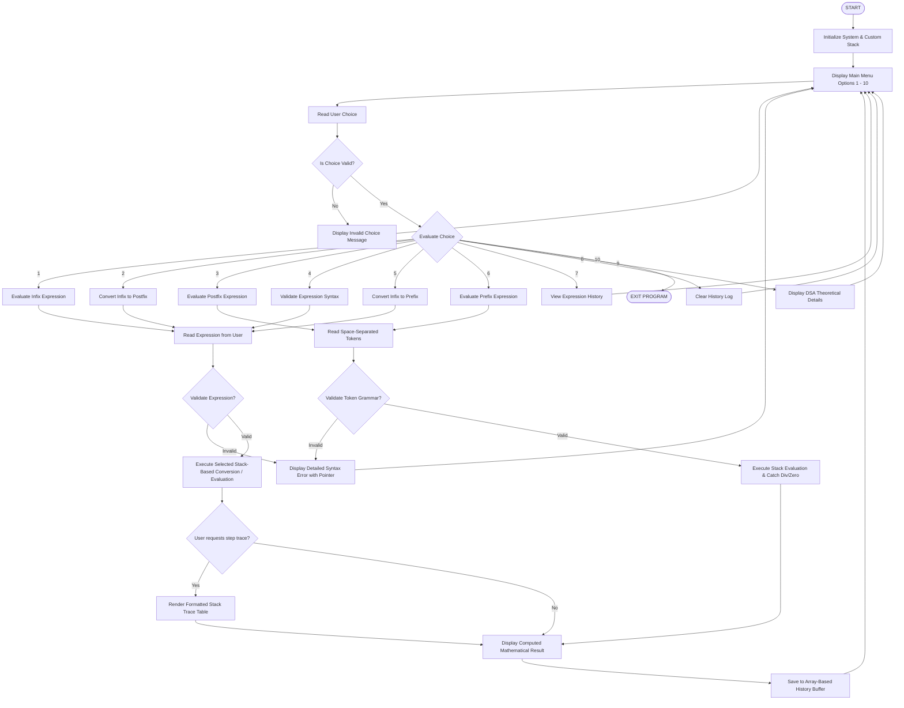

# System Flowcharts — Expression Evaluation System

This document contains Mermaid diagrams and structured flowcharts illustrating the control flow and algorithm execution of the system.

---

## 1. Overall System Architecture & Menu Control Flow



---

## 2. Detailed Infix to Postfix Conversion Flow (Shunting-Yard)

```mermaid
flowchart TD
    S([Start Infix to Postfix]) --> Tok[Tokenize Infix String into Operands, Operators, Parentheses]
    Tok --> InitStack[Initialize Custom Array Stack `opStack`]
    InitStack --> NextTok{More Tokens Remaining?}

    NextTok -- No --> PopRem{Is `opStack` Empty?}
    PopRem -- No --> PopOut[Pop Operator from Stack -> Append to Output Buffer] --> PopRem
    PopRem -- Yes --> RetPost([Return Joined Space-Separated Postfix String])

    NextTok -- Yes --> ReadT[Read Next Token `T`]
    ReadT --> TypeCheck{Check Token Type}

    TypeCheck -- Operand Number --> AppendOut[Append `T` directly to Output Buffer] --> NextTok

    TypeCheck -- Opening Parenthesis '(' --> PushParen[Push '(' onto `opStack`] --> NextTok

    TypeCheck -- Closing Parenthesis ')' --> LoopParen{Top of `opStack` == '('?}
    LoopParen -- No --> PopP[Pop Top Operator -> Append to Output Buffer] --> LoopParen
    LoopParen -- Yes --> DiscardP[Pop and Discard '(' from `opStack`] --> NextTok

    TypeCheck -- Operator `op` --> PrecLoop{`opStack` not empty AND top != '(' AND<br>prec(top) > prec(op) OR<br>(prec(top) == prec(op) AND left-associative)?}
    PrecLoop -- Yes --> PopOp[Pop Top Operator -> Append to Output Buffer] --> PrecLoop
    PrecLoop -- No --> PushOp[Push `op` onto `opStack`] --> NextTok
```

---

## 3. Detailed Postfix Evaluation Flow

```mermaid
flowchart TD
    EStart([Start Postfix Evaluation]) --> Split[Split Postfix String by Whitespace into Tokens]
    Split --> InitValStack[Initialize Custom Array Stack `valStack<double>`]
    InitValStack --> HasMore{More Tokens?}

    HasMore -- Yes --> GetToken[Read Next Token `token`]
    GetToken -- Is Number --> PushNum[Convert String to double -> Push to `valStack`] --> HasMore

    GetToken -- Is Operator `op` --> CheckOperands{`valStack.size()` >= 2?}
    CheckOperands -- No --> ErrUnderflow([Raise Error: Insufficient Operands])
    CheckOperands -- Yes --> PopTwo[Pop `op2 = valStack.pop()`<br>Pop `op1 = valStack.pop()`]

    PopTwo --> DivZero{`op` == '/' or '%' AND `abs(op2) < 1e-12`?}
    DivZero -- Yes --> ErrDiv([Raise Error: Division or Modulo by Zero])
    DivZero -- No --> Calc[Compute `res = op1 <op> op2`<br>Support +, -, *, /, %, ^]
    Calc --> PushRes[Push `res` to `valStack`] --> HasMore

    HasMore -- No --> CheckFinal{`valStack.size()` == 1?}
    CheckFinal -- No --> ErrExtra([Raise Error: Extra Operands Leftover])
    CheckFinal -- Yes --> ReturnRes([Return Final Result: `valStack.pop()`])
```
